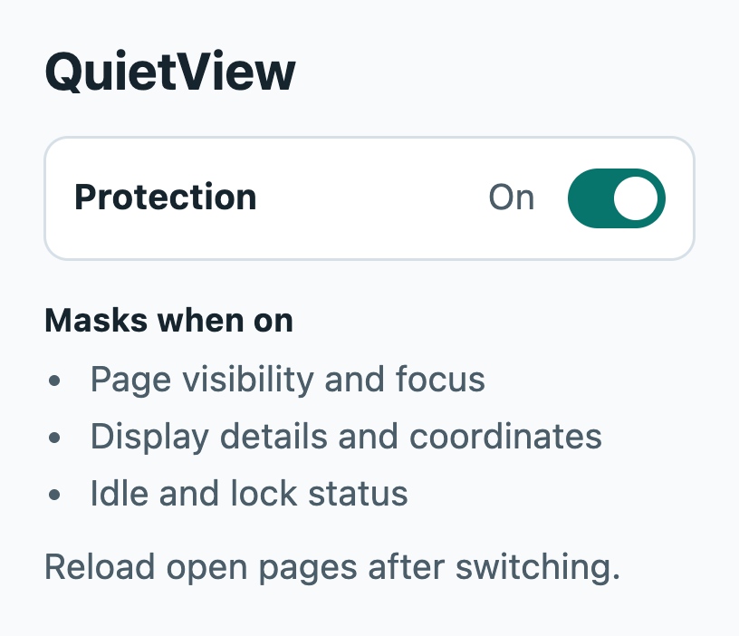
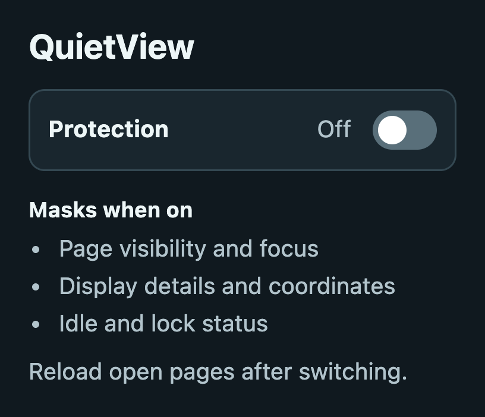

# QuietView

A desktop Chrome extension for exploring attention and display privacy through selected browser-signal substitutions.

## Overview

Webpages can ask whether a tab is visible, whether its window has focus, and what displays are connected. QuietView lets you explore what changes when a page receives a consistent visible, focused, single-display readout. It processes those signals on the device.

## Installation

Download the [repository ZIP](https://github.com/ant0n-grachev/QuietView/archive/refs/heads/main.zip), or clone the source below. The [local diagnostic](docs/DETAILS.md#local-diagnostic) shows what an installed copy reports in Chrome.

<p>
  <a href="docs/images/popup-on.png"></a>
  <a href="docs/images/popup-off.png"></a>
</p>

## Features

- Turn protection on or off from the popup. Your setting stays on this browser.
- Substitutes selected page visibility and focus values and filters visibility timeline entries.
- Reports one virtual display and normalizes selected screen coordinates.
- Substitutes supported main-window idle and lock readouts while preserving native permission checks.
- Preserves ordinary form input and uses native fullscreen controls by default.

## How it works

While protection is on, a registered content script runs at `document_start` in the page’s JavaScript world on eligible pages and frames. It wraps selected APIs and filters specific events. The popup changes that registration and the diagnostic lets you check readouts for yourself. See the [privacy policy](PRIVACY.md) for site access and data handling.

## Tech stack

- **Chrome Manifest V3** defines the content script, frame matching, and popup.
- **Plain JavaScript** implements the substitutions and diagnostic. Installation uses the source files directly.
- **Python and Playwright** run DOM fixtures and installed-extension tests in Chromium.

## Getting started

Use desktop Chrome or Chromium 119 or later. No build, account, API key, or data download is required.

```bash
git clone https://github.com/ant0n-grachev/QuietView.git
cd QuietView
```

1. Open `chrome://extensions` and enable **Developer mode**.
2. Select **Load unpacked** and choose the `extension` folder.
3. Reload the webpages you want to test. After updating the source, reload the extension before reloading those pages.

## Configuration

Protection starts on. Use the QuietView popup to switch it on or off, then reload open pages to apply the change. Use Chrome’s extension settings to restrict site access or enable optional file URL access. The [configuration reference](docs/DETAILS.md#pause-restrict-sites-or-customize) covers individual feature switches. Fullscreen and display-mode substitutions default to off.

## Testing

Follow the [test setup](docs/TESTING.md) for pinned Playwright and Chromium. Run these commands from the repository root:

```bash
for script in extension/*.js; do node --check "$script"; done
python tests/check_version.py
python tests/test_core.py
python tests/test_timeline_fixtures.py
python tests/test_attention_regressions.py
python tests/test_browser.py --headless
```

The installed-extension suite uses a disposable Chromium profile and an unpatched control. Fixture tests inject the script directly. The [verification record](docs/TESTING.md#latest-verification) lists observed results, skipped native checks, and separate desktop and hardware checks.

## Limitations

Substitutions are best-effort. After an unpacked browser restart, a page opened immediately may load before protection is ready. Workers, service workers, newly created frames, and browser scheduling can expose signals outside coverage. Screen sharing, native permission decisions, and network identifiers remain under browser and website control. Some sites may behave differently if they depend on visibility events. See [behavior and limitations](docs/DETAILS.md#important-limits-and-possible-breakage) for specific examples.

## Project structure

- [`extension/`](extension/) contains the manifest, content script, popup, and local diagnostic.
- [`tests/`](tests/) contains the manifest check, DOM fixtures, and browser tests.
- [Behavior and limitations](docs/DETAILS.md), [testing](docs/TESTING.md), and [research notes](RESEARCH.md) cover implementation, evidence, and web-platform references.

## Versioning and credits

Current source version **v1.1.0**. The [manifest](extension/manifest.json) defines the application version. See the [changelog](CHANGELOG.md) for unreleased changes and the historical `v1` tag.

QuietView is maintained by Anton Grachev and distributed under the [MIT License](LICENSE). For bug reports, include the browser version and a minimal public or local reproduction.
